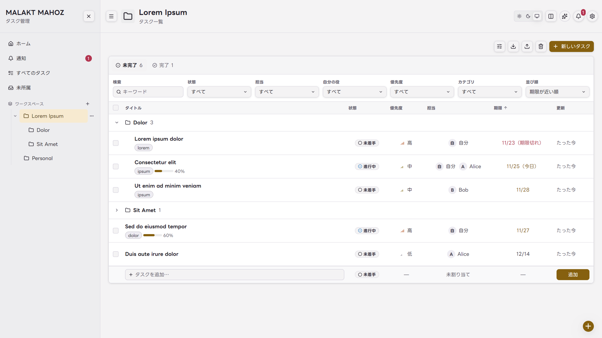
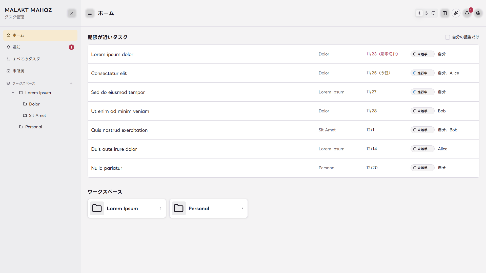
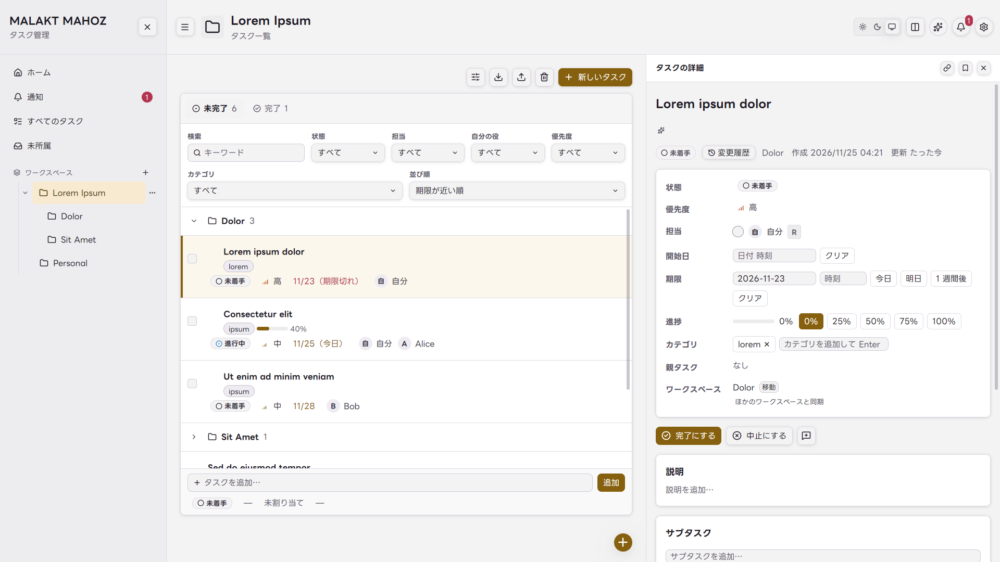
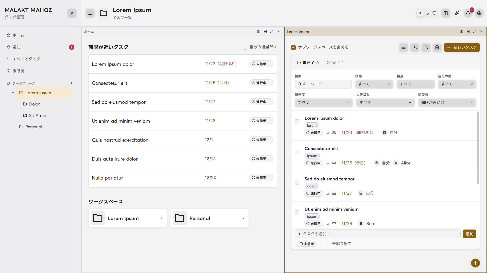
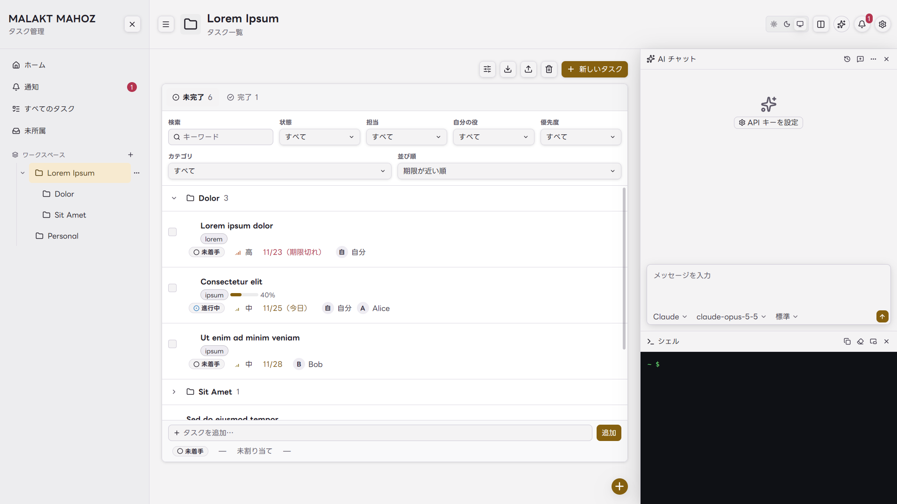
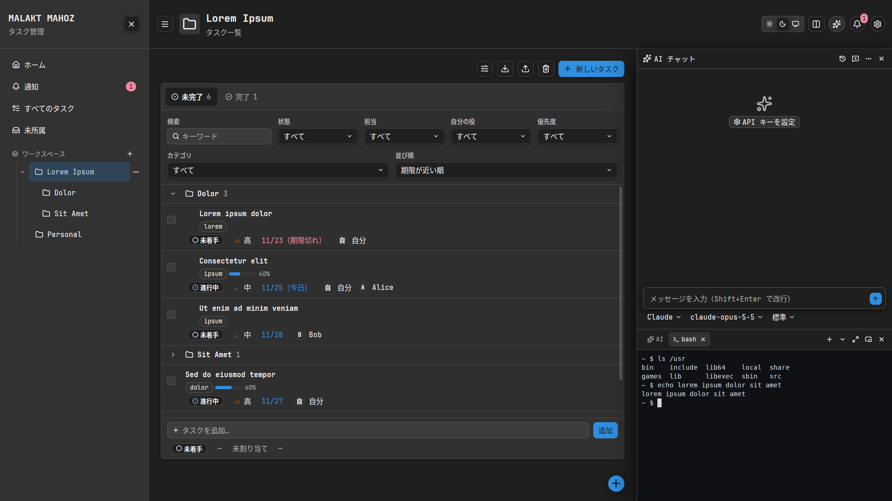
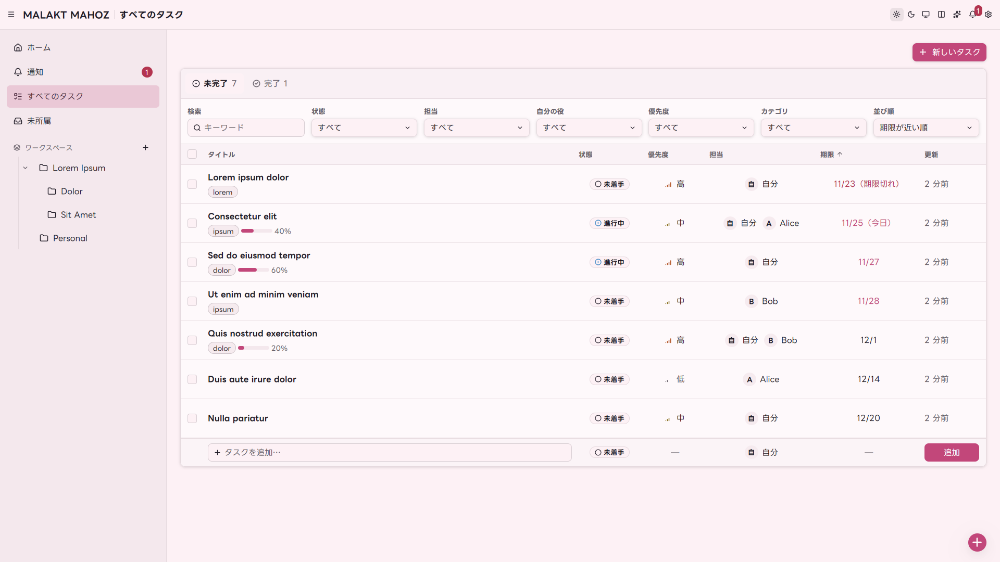
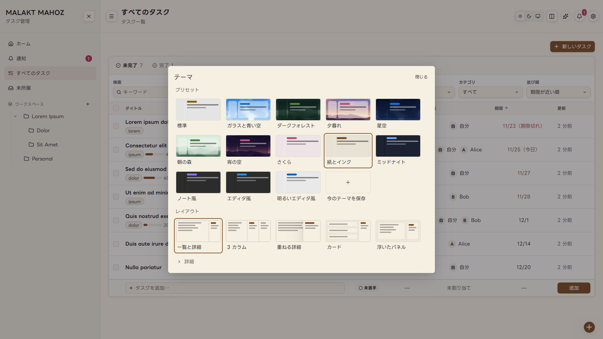

# malakt-mahoz

[](https://github.com/richinosan/malakt-mahoz/actions/workflows/ci.yml)
[](https://github.com/richinosan/malakt-mahoz/releases/latest)
[](LICENSE)


オフラインで使うタスク管理ツールです。Rust と [gpui](https://www.gpui.rs/) で作っていて、macOS・Windows・Linux で動きます。


<sub>タスクの一覧</sub>

| | |
| --- | --- |
| <br><sub>ホーム</sub> | <br><sub>タスクの詳細</sub> |
| <br><sub>ペイン</sub> | <br><sub>AI チャット</sub> |
| <br><sub>ターミナル</sub> | <br><sub>すべてのタスク</sub> |


<sub>カスタマイズ</sub>

## 機能

- **ワークスペース**: 入れ子にできます。タスクはどこにも入れずに置くこともできます
- **タスク**: 状態、優先度、開始と期限（「明日」「11/27 14時」のように入力。一覧では「11/24～11/27」か「あと 3 日」で表示）、進捗、カテゴリ、サブタスク、説明（Markdown）、変更履歴（誰がいつ作り、何をどう変えたか。自分・AI・外のエージェントを分けて残す）
- **担当者**: 名前だけで登録でき、役（RACI）を付けられます。複数人のときは 1 人ずつ完了にできます
- **コメント**: Markdown、ピン留め、`@名前`、完了報告、説明の文章に付けるレビューコメント
- **添付ファイル**: 1 ファイル 10 MiB、1 タスク 500 件まで
- **タスク追加時の既定値**: ワークスペースごとに担当者・期限・優先度・カテゴリ・説明の雛形
- **一覧**: 検索、絞り込み、並べ替え、複数選択での一括変更
- **ホーム**: 期限が 30 日以内のタスクと期限が過ぎたタスク
- **通知**: 期限が近いタスク（何分前・何日前に知らせるかを選べます。[docs/notices.md](docs/notices.md)）と、ほかの人からの完了報告
- **ペイン**: 画面を分けて、配置をプリセットとして保存
- **カスタマイズ**: テーマ 13 個、レイアウト、密度、背景の画像、書体、色。自分のテーマを保存
- **マルチウィンドウ**: `Ctrl/⌘ + N`
- **ロック**: パスキー（Windows Hello、Touch ID、fprintd）。`Ctrl/⌘ + L`。操作がないときに自動でロックする時間を選べます。ロック中も OS の通知は届きます（[docs/lock.md](docs/lock.md)）
- **エクスポート / インポート**: 全データを zip 1 つに書き出し、別の端末で取り込み
- **リマインダーとの連携**（標準はオフ）: macOS の「リマインダー」、Windows の通知（[docs/reminders.md](docs/reminders.md)）
- **自動アップデート**: GitHub Releases の新しい版に入れ替え（[docs/update.md](docs/update.md)）
- **完了チケット**: コマンドからタスクを完了にする（[docs/tickets.md](docs/tickets.md)）
- **AI チャット**: `Ctrl/⌘ + J`（[docs/ai.md](docs/ai.md)）
- **ターミナル**: アプリの中で WSL や zsh を開き、Claude Code などをそのまま動かす（[docs/terminal.md](docs/terminal.md)）
- **MCP サーバー**: Claude Code などのエージェントからタスクを読み書き（[docs/mcp.md](docs/mcp.md)）

## 起動とビルド

[mise](https://mise.jdx.dev/) を使います。

```sh
mise install        # Rust を入れる
mise run dev        # 開発用に起動する
mise run start      # リリースビルドで起動する
mise run build      # target/release/malakt-mahoz を作る
```

Linux では次のライブラリが必要です（Ubuntu の例）。

```sh
sudo apt-get install clang pkg-config libxcb1-dev libxkbcommon-dev libxkbcommon-x11-dev \
  libwayland-dev libvulkan-dev libfontconfig-dev libfreetype-dev libssl-dev libasound2-dev libzstd-dev \
  libwebkit2gtk-4.1-dev libgtk-3-dev
```

データベースは OS のデータ用フォルダの `malakt-mahoz/data.sqlite3` です。環境変数 `MALAKT_MAHOZ_DB` で場所を変えられます。

## テスト

```sh
mise run test       # ユニットテストとシナリオテスト
mise run lint       # 書式と clippy
mise run verify     # 書式、clippy、テスト
mise run hooks      # コミットの前に verify を走らせるフックを入れる
mise run bench      # 1 万件のタスクでの一覧・検索・エクスポートの時間
mise run mutants    # ミューテーションテスト（cargo-mutants が必要）
```

## ドキュメント

- [完了チケット](docs/tickets.md)
- [AI チャット](docs/ai.md)
- [ターミナル](docs/terminal.md)
- [Claude Code などから使う（MCP）](docs/mcp.md)
- [リマインダーとの連携](docs/reminders.md)
- [自動アップデート](docs/update.md)
- [エクスポートの形式](docs/export.md)
- [設計（構成、速さ、ディスクの使い方、モバイル）](docs/design.md)
- [テストとリリース](docs/testing.md)

## ライセンス

Apache-2.0
